# Renda Fixa Quant BR

> Ferramenta open source para **análise quantitativa de renda fixa brasileira** — precificação STN/ANBIMA, duration, DV01, convexidade, YTM, curva de juros (ETTJ), marcação a mercado e comparação líquida de IR.

[](https://github.com/coach-sarmelo/renda-fixa-quant-br/actions/workflows/ci.yml)
[](https://www.python.org/downloads/)
[](LICENSE)

---

## Funcionalidades

| Módulo | O que faz | Onde |
|--------|-----------|------|
| **Precificação** | Avaliação unificada (`precificar` → `AvaliacaoTitulo`) de títulos nominais e indexados ao IPCA (`--vna`, NTN-B/NTN-B Principal pela cotação em % do VNA) com cupom composto STN/ANBIMA, calendário real B3/SFN e liquidação D+1; YTM por Brent e marcação a mercado (linear e exata acoplada à ETTJ) | CLI e biblioteca |
| **Risco** | Duration (Macaulay e modificada), DV01 (diferença finita para +1 bp e aproximação analítica), convexidade (forma fechada base 252) e variação de PU de 2ª ordem (Duration + Convexidade) | CLI (`rfq tesouro precificar`) e biblioteca |
| **Curva de juros** | ETTJ com flat-forward (padrão B3/ANBIMA) como método default; interpolação linear e Nelson-Siegel disponíveis; conversões nominal↔efetiva e pré↔IPCA+ (Fisher exata) | Biblioteca |
| **Comparação** | IR regressivo + IOF encadeados, isenção derivada por categoria de produto (LCI, LCA, debênture incentivada Lei 12.431/2011), comparação nas convenções linear e composta, e resumo de fundos vs. CDI (`resumir_fundo`) | CLI e biblioteca |
| **Dados** | Tesouro Direto (CSV oficial do Tesouro Transparente), CDI diário (série 12 do SGS/BCB) e fundos de investimento (informes diários da CVM) — fontes oficiais públicas, sem token, com cache local em disco | CLI e biblioteca |
| **Interfaces** | CLI (`rfq`), notebooks Jupyter executados e biblioteca Python tipada | — |

## Validação empírica e rigor quantitativo

O núcleo de precificação é validado por testes de regressão contra o `PU Compra Manhã` oficial publicado pelo Tesouro Nacional (excertos extraídos byte a byte do CSV oficial do Tesouro Transparente em `tests/fixtures/`):

- **Calendário real B3/SFN + liquidação D+1 + cupom semestral composto $(1 + c)^{1/2} - 1$**: erros relativos medidos de **$\le 1,7 \times 10^{-5}$** em LTN (`Tesouro Prefixado`) e **$\le 9,39 \times 10^{-5}$** em NTN-F (`Tesouro Prefixado com Juros Semestrais`), além de regressão da cotação real da NTN-B (`Tesouro IPCA+`). Metodologia e medições completas em [Fontes de dados](docs/dados.md) e [Fórmulas](docs/formulas.md).
- **Suíte determinística offline**: mais de 390 testes automatizados (`pytest`, `mypy`, `ruff`) executáveis sem rede e sem chaves de API.

## Instalação

Requisitos: Python 3.11+ e `make` (no Windows: `scoop install make` ou `choco install make`).

```bash
git clone https://github.com/coach-sarmelo/renda-fixa-quant-br.git
cd renda-fixa-quant-br

python -m venv .venv
source .venv/bin/activate      # Windows: .venv\Scripts\activate
make install-dev               # pip install -e ".[dev]"
```

(ou diretamente `pip install -e ".[dev]"`)

## Uso rápido (CLI) — sem token

Os comandos abaixo funcionam imediatamente após a instalação, sem nenhuma
configuração:

```bash
# 1) Listar títulos do Tesouro Direto — fonte oficial (Tesouro Transparente), sem token
rfq tesouro listar --fonte=oficial
rfq tesouro listar --fonte=oficial --tipo IPCA+

# 2) Precificar um título nominal ou NTN-B com VNA (matemática pura, sem rede)
rfq tesouro precificar --vencimento 2035-05-15 --taxa 0.062 --cupom 0.06
rfq tesouro precificar --vencimento 2035-05-15 --taxa 0.062 --cupom 0.06 --vna 4500.00

# 3) Comparar CDB vs LCI vs Tesouro vs Debênture incentivada pelo líquido de IR
rfq comparar --cdb 12.0 --lci 10.5 --tesouro 11.8 --debenture 10.2 --incentivada --prazo 720

# 4) Resumo rápido do Tesouro Direto de hoje (fonte oficial)
rfq hoje

# 5) Listar títulos com a fonte resolvida automaticamente (a CLI anuncia "fonte: oficial")
rfq tesouro listar --fonte=auto

# 6) Comparar CDB a 110% do CDI com o CDI real da série SGS/BCB (sem token)
rfq comparar --cdb-cdi 110 --cdi-auto --prazo 720

# 7) Resumo de um fundo de investimento no mês (troque pelo CNPJ real; informe da CVM, sem token)
rfq fundos resumo --cnpj 00.017.024/0001-53 --mes 2026-08
```

Exemplo de saída do `precificar` (executado em 2026-10-01; a data de
referência é sempre a data atual):

```
PU:              R$ 1,012.67
Duration Mac:   6.6626 anos
Duration Mod:   6.2737
DV01:           R$ 0.6350 / bp
Convexidade:    52.2252
Current Yield:  5.8386%
```

## Configuração (`.env`)

Opcional: copie o exemplo e preencha apenas o que for usar.

```bash
cp .env.example .env
```

| Variável | Para quê | Padrão |
|----------|----------|--------|
| `RFQ_CACHE_DIR` | diretório de cache de dados | `~/.rfquant/cache` |
| `BRAPI_TOKEN` | reservado à fonte `brapi` — **não utilizável hoje** (exige plano pago; ver [dados.md](docs/dados.md)) | — |

O `.env.example` lista também `RFQ_DB_PATH` e `RFQ_LOG_LEVEL` — variáveis
reservadas, sem efeito na prática hoje.

## Relatório de exemplo

```bash
rfq relatorio gerar --output relatorio.md
```

## Uso como biblioteca

```python
from datetime import date
from rfquant.comparison import taxa_equivalente
from rfquant.pricing import marktomarket, precificar
from rfquant.pricing.curva_juros import ETTJ

# 1) Avaliação completa em uma única passagem (nominal ou NTN-B com `vna=...`)
av = precificar(
    data_base=date(2026, 1, 2),
    data_vencimento=date(2035, 5, 15),
    taxa_anual=0.062,
    taxa_cupom_anual=0.06,
)
print(f"PU: R$ {av.pu:,.2f} | D_mod: {av.duration_modificada:.4f} | DV01: R$ {av.dv01:.4f}/bp")

# 2) Marcação a mercado acoplada à ETTJ (flat-forward B3/ANBIMA)
curva = ETTJ([(1.0, 0.055), (3.0, 0.057), (5.0, 0.058), (10.0, 0.060)])
mtm = marktomarket.exata(
    data_compra=date(2026, 1, 2),
    data_hoje=date(2026, 6, 1),
    data_vencimento=date(2035, 5, 15),
    taxa_compra=0.062,
    taxa_cupom_anual=0.06,
    ettj=curva,
)
print(f"PU na curva: R$ {mtm.pu_curva:,.2f} -> PU mercado: R$ {mtm.pu_mercado:,.2f} ({mtm.variacao_percentual:+.2%})")

# 3) Comparação líquida de IR com isenção derivada por categoria e convenção composta
produtos = [
    taxa_equivalente.ProdutoRF("CDB 12%", 0.12, 720, categoria="CDB"),
    taxa_equivalente.ProdutoRF("Debênture Incentivada 10%", 0.10, 720, categoria="debênture-incentivada"),
]
for r in taxa_equivalente.comparar(produtos, convencao="composta"):
    print(f"{r.produto.nome}: líquido {r.taxa_liquida_anual:.4%} (equiv. CDB {r.equivalente_cdb:.4%})")
```

Mais exemplos (YTM, NTN-B com VNA, ETTJ Nelson-Siegel, IR/IOF, fundos CVM vs. CDI) em
[Uso detalhado](docs/uso.md), e os três notebooks executados (`02_precificacao_tesouro.ipynb`, `03_comparacao_liquida_ir.ipynb` e `04_curva_ettj_e_risco.ipynb`) em [`notebooks/`](notebooks/).


## Arquitetura



```
src/rfquant/
├── data/            # Providers oficiais (Tesouro, SGS/BCB, CVM), calendário B3/SFN e cache em disco
├── pricing/         # Avaliação unificada (PU, cotação VNA, durations, DV01, convexidade, CY), YTM, MtM e ETTJ
├── comparison/      # IR regressivo, IOF, taxa equivalente, comparação linear/composta e resumo de fundos
├── cli.py           # Interface de linha de comando (rfq)
├── relatorio.py     # Relatório determinístico (Markdown)
└── config.py        # Settings (pydantic-settings, lê .env)
```


## Documentação

- [Índice](docs/index.md)
- [Arquitetura](docs/arquitetura.md)
- [Fórmulas](docs/formulas.md)
- [Fontes de dados](docs/dados.md)
- [Uso detalhado](docs/uso.md)

## Disclaimer

Esta ferramenta é **educacional e informacional**. Não constitui consultoria de valores mobiliários.

## Licença

MIT — veja [LICENSE](LICENSE).
